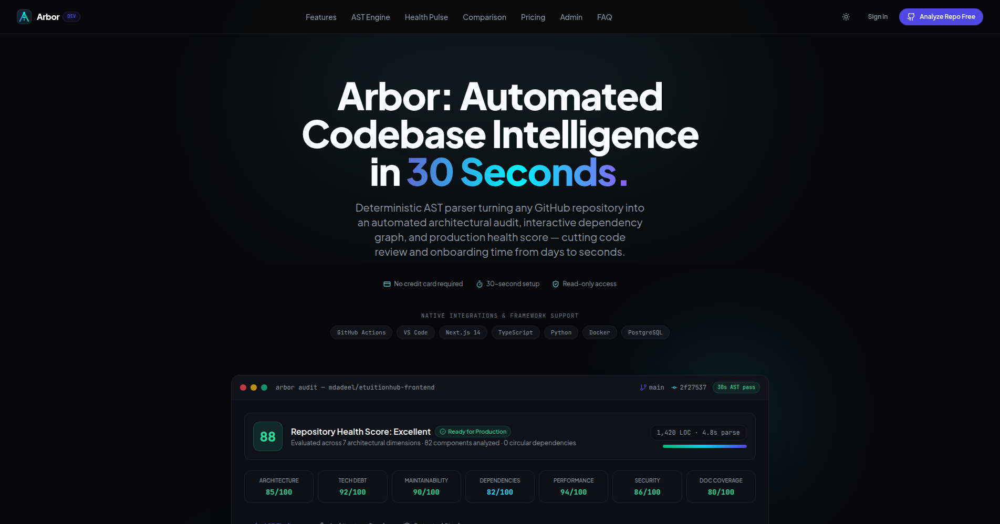

<h1 align="center">Shahnawas Adeel</h1>

  <strong>Full-Stack Software Engineer — SaaS Architecture, Developer Tooling &amp; Design Systems</strong> 
  Chattogram, Bangladesh (UTC+6) · Remote Worldwide · Open to Full-Time SWE Roles &amp; Technical Collaborations

  <picture>
    <source media="(prefers-color-scheme: dark)" srcset="https://readme-typing-svg.demolab.com?font=Fira+Code&amp;weight=600&amp;size=20&amp;duration=2800&amp;pause=1200&amp;color=A78BFA&amp;center=true&amp;vCenter=true&amp;width=720&amp;height=40&amp;lines=TypeScript+%E2%80%A2+Next.js+%E2%80%A2+React+%E2%80%A2+Node.js+%E2%80%A2+PostgreSQL+%E2%80%A2+Python;Creator+of+Arbor+%E2%80%A2+easyui+%E2%80%A2+Preen+%E2%80%A2+e-TuitionBD;Deterministic+Architecture+%E2%80%A2+Accessible+UI+%E2%80%A2+Production+DX" />
    <source media="(prefers-color-scheme: light)" srcset="https://readme-typing-svg.demolab.com?font=Fira+Code&amp;weight=600&amp;size=20&amp;duration=2800&amp;pause=1200&amp;color=6D28D9&amp;center=true&amp;vCenter=true&amp;width=720&amp;height=40&amp;lines=TypeScript+%E2%80%A2+Next.js+%E2%80%A2+React+%E2%80%A2+Node.js+%E2%80%A2+PostgreSQL+%E2%80%A2+Python;Creator+of+Arbor+%E2%80%A2+easyui+%E2%80%A2+Preen+%E2%80%A2+e-TuitionBD;Deterministic+Architecture+%E2%80%A2+Accessible+UI+%E2%80%A2+Production+DX" />
    
  </picture>

  &nbsp;
  &nbsp;
  

---

## About Shahnawas Adeel

**Shahnawas Adeel** (`@mdadeel`) is a **Full-Stack Software Engineer** building type-safe web platforms, developer tools, design systems, and Linux desktop utilities. Through **Inventra Technologies** and open-source engineering, he ships end-to-end software across **TypeScript, Next.js, React, Node.js, PostgreSQL, Redis, Docker, and Python**.

- **Developer Tooling & Static Analysis:** Built **[Arbor](https://github.com/mdadeel/Arbor)**, a self-hostable codebase intelligence portal using Babel AST static analysis, a 30-model Prisma/PostgreSQL schema, and BullMQ + Redis workers.
- **Design Systems & Frontend Infrastructure:** Created **[easyui](https://github.com/mdadeel/easyui)**, a `pnpm` monorepo React component library (`@easyui/react`) and CSS custom-property token pipeline (`@easyui/tokens`) with runtime theming and accessibility tests.
- **Linux Systems & Open Source:** Author of **[Preen](https://github.com/mdadeel/Preen)** (`v0.7.1`), an MIT-licensed Python 3 and GTK 3 desktop system utility for Debian and Ubuntu distributions.
- **Multi-Tenant SaaS:** Engineered **[e-TuitionBD](https://e-tuitionhub.vercel.app/)**, a multi-role EdTech marketplace supporting real-time messaging, role-based dashboards, and escrow payment workflows.

---

## Featured Software & Case Studies

### 1. [Arbor](https://github.com/mdadeel/Arbor) — Automated Codebase Intelligence & Developer Portal

  

 

**Arbor** connects to GitHub repositories to generate an inspectable architecture map, multi-dimension health score, and evidence-linked static analysis findings in ~30 seconds. Core analysis is **deterministic** — parsing source trees with `@babel/parser` and rule-based static checks — with optional bring-your-own-key (BYOK), review-only AI patch explanations that never mutate repository state.

- **Asynchronous Analysis Pipeline:** Shallow-clones target repositories in isolated background jobs via **BullMQ + Redis 7**, computes dependency graphs (`dagre` + **React Flow**), and cleans up ephemeral workspaces automatically.
- **End-to-End Type Safety:** Strict **TypeScript**, **Next.js 14 (App Router)**, **tRPC v11**, **TanStack Query**, and **PostgreSQL 16 + Prisma ORM** across 30 relational models, tested with **Vitest** and **Playwright**.
- **Single-Command Self-Hosting:** Ships with a production `Dockerfile` and `docker-compose.yml` bundling PostgreSQL, Redis, schema migrations, health checks, and worker processes.

**Links:** [GitHub Repository (`mdadeel/Arbor`)](https://github.com/mdadeel/Arbor) · [Live Application (`arborgit.vercel.app`)](https://arborgit.vercel.app/)

---

### 2. [e-TuitionBD](https://e-tuitionhub.vercel.app/) — Multi-Role EdTech SaaS Marketplace

  

 

**e-TuitionBD** is a full-stack tuition marketplace connecting students, verified tutors, parents, and educational institutions across Bangla, English, Cambridge, and IB curricula.

- **Role-Based Platform Workflows:** Dedicated dashboards and granular RBAC across Student, Tutor, Organization, and Admin roles with URL-synced search filters and multi-step tutor verification.
- **Real-Time & Transactional Infrastructure:** Built with **React 19**, **Vite 7**, and **Tailwind CSS** on the client, paired with **Node.js**, **Express**, **MongoDB**, **Redis**, **Socket.IO** live notifications, **Firebase Authentication**, and **Stripe** payment integration.
- **Automated Quality Assurance:** Backed by **Playwright** end-to-end browser tests and **Vitest** unit tests.

**Links:** [Frontend Repository (`mdadeel/etuitionhub-frontend`)](https://github.com/mdadeel/etuitionhub-frontend) · [Live Platform (`e-tuitionhub.vercel.app`)](https://e-tuitionhub.vercel.app/)

---

## Engineering Portfolio Overview

| Project | Domain | Architecture & Key Engineering Highlights | Tech Stack | Links |
| :--- | :--- | :--- | :--- | :--- |
| **[Arbor](https://github.com/mdadeel/Arbor)** | Developer Tooling / Static Analysis | Deterministic Babel AST parser, interactive React Flow dependency maps, 30-model Prisma schema, BullMQ worker queue, Docker Compose self-hosting | TypeScript, Next.js 14, tRPC, PostgreSQL, Prisma, Redis, BullMQ | [Repo](https://github.com/mdadeel/Arbor) · [Live](https://arborgit.vercel.app/) |
| **[easyui](https://github.com/mdadeel/easyui)** | Design System / UI Component Library | `pnpm` workspace monorepo compiling JSON design tokens (`@easyui/tokens`) to CSS custom properties and accessible React primitives (`@easyui/react`) with runtime theme customization | TypeScript, React, CSS Custom Properties, pnpm Workspaces, Cloudflare Workers | [Repo](https://github.com/mdadeel/easyui) · [Playground](https://easyui.mdadeel125.workers.dev/) |
| **[Preen](https://github.com/mdadeel/Preen)** | Linux Desktop / Systems Utility | Open-source native Linux utility (`v0.7.1`, MIT) for APT, Flatpak, AppImage & `.deb` package management, disk cleanup with size previews, `systemd` service inspection, and config backups | Python 3, GTK 3, Linux (`apt`, `flatpak`, `systemd`), Debian Packaging | [Repo](https://github.com/mdadeel/Preen) · [Releases](https://github.com/mdadeel/Preen/releases) |
| **[e-TuitionBD](https://github.com/mdadeel/etuitionhub-frontend)** | EdTech / Multi-Role Marketplace | Multi-role student/tutor/org dashboards, real-time Socket.IO messaging, Firebase Auth, Stripe payment flows, Playwright E2E suite | React 19, Vite, Tailwind CSS, Node.js, Express, MongoDB, Redis, Socket.IO | [Frontend Repo](https://github.com/mdadeel/etuitionhub-frontend) · [Live](https://e-tuitionhub.vercel.app/) |
| **[CodeArena](https://github.com/Arafat-Shalehin/CodeArena)** | Competitive Programming / Online Judge | Collaborative team platform with isolated Docker-sandboxed multi-language code execution, live contests, dynamic leaderboards, and AI interview simulation | Next.js, Node.js, Docker, BullMQ, Redis, Socket.IO, MongoDB | [Repo](https://github.com/Arafat-Shalehin/CodeArena) · [Live](https://codearena-9ymb.onrender.com/) |

---

## Production Tech Stack

  
  
  
  
  
  
  
  
  
  
  
  
  
  
  

| Layer | Core Technologies | Applied In Production |
| :--- | :--- | :--- |
| **Languages** | TypeScript (strict), JavaScript (ES2024), Python 3, SQL, Bash | Full-stack web applications, AST tooling, Linux desktop utilities, CLI automation |
| **Frontend & UI Systems** | Next.js (App Router), React 19, Tailwind CSS, Radix UI, TanStack Query, React Flow, Recharts, Framer Motion | `Arbor`, `easyui` (`@easyui/react` & `@easyui/tokens`), `e-TuitionBD` |
| **Backend & APIs** | Node.js, tRPC v11, Express.js, BullMQ, Socket.IO, NextAuth.js, Firebase Auth, Stripe API | Background worker queues, real-time messaging, OAuth & RBAC, marketplace payments |
| **Data & Caching** | PostgreSQL 16, Prisma ORM, MongoDB (Mongoose), Redis 7 (`ioredis`) | Relational schema design (30+ models), job queues, session & query caching |
| **DevOps, Testing & Desktop** | Docker, Docker Compose, Playwright (E2E), Vitest, pnpm Monorepos, Cloudflare Workers, GTK 3, Debian Packaging | Containerized self-hosting, automated E2E/unit testing, Linux `.deb` & AppImage tooling |

---

## Frequently Asked Questions

<strong>What roles and engagements is Shahnawas Adeel open to?</strong>

 
Shahnawas Adeel is open to <strong>Full-Time Software Engineer / Full-Stack Developer roles</strong> (remote worldwide or hybrid/onsite in Bangladesh), as well as select <strong>contract SaaS engineering</strong> and open-source collaborations through Inventra Technologies.

<strong>Which repositories best demonstrate his engineering depth?</strong>

 
<ul>
  <li><strong>Full-Stack &amp; Distributed Worker Architecture:</strong> <a href="https://github.com/mdadeel/Arbor">Arbor</a> (Next.js 14, strict TypeScript, tRPC, Babel AST, PostgreSQL/Prisma, BullMQ + Redis, Docker Compose).</li>
  <li><strong>Frontend Infrastructure &amp; Design Systems:</strong> <a href="https://github.com/mdadeel/easyui">easyui</a> (<code>pnpm</code> monorepo, design token compiler, accessible React components, live Cloudflare Workers playground).</li>
  <li><strong>Python &amp; Linux Systems Programming:</strong> <a href="https://github.com/mdadeel/Preen">Preen</a> (native GTK 3 desktop application, Debian packaging, APT/Flatpak/AppImage/<code>systemd</code> tooling, MIT licensed).</li>
</ul>

<strong>Where is Shahnawas Adeel located and what timezones does he work across?</strong>

 
Based in <strong>Chattogram, Bangladesh (Asia/Dhaka, UTC+6)</strong>, experienced collaborating asynchronously and overlapping synchronously with engineering teams across <strong>Europe (GMT/CET), Asia-Pacific, and US morning hours</strong>.

---

## Contact & Links

- **Portfolio:** [https://mdadeel.me](https://mdadeel.me/)
- **LinkedIn:** [linkedin.com/in/shahnawasadee1](https://www.linkedin.com/in/shahnawasadee1/)
- **Email:** [shahnawasadeel@gmail.com](mailto:shahnawasadeel@gmail.com)
- **GitHub:** [github.com/mdadeel](https://github.com/mdadeel)
