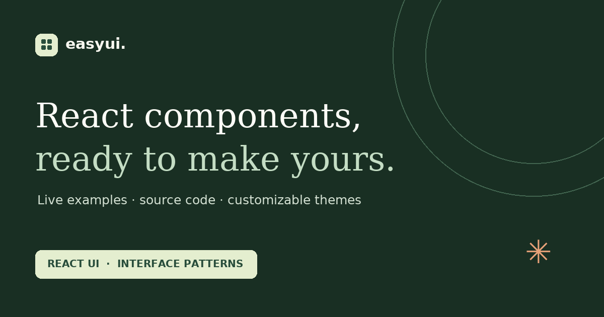
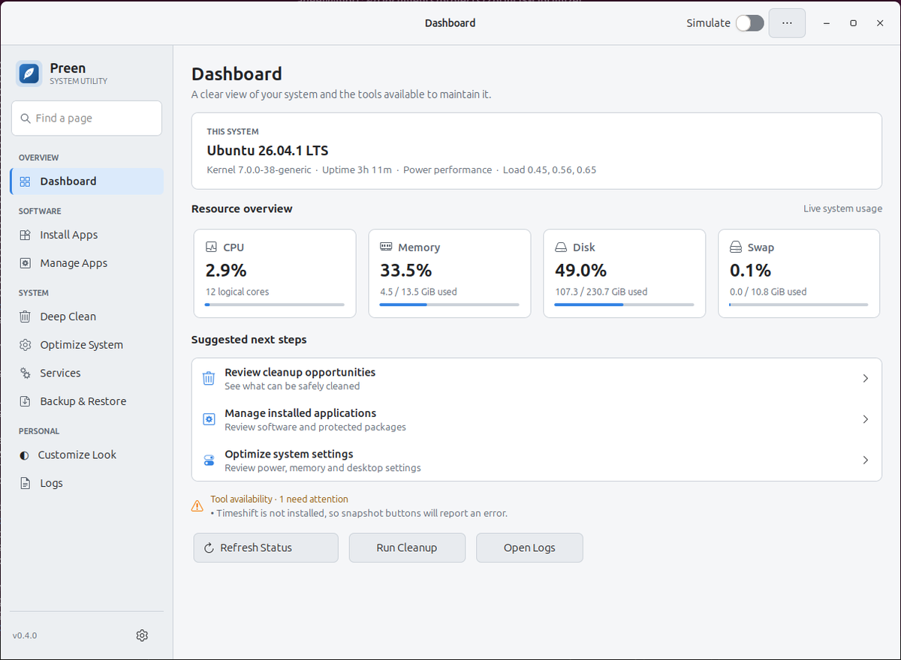

**I build the whole product: database schema, background jobs, deployment, and the interface on top.**

TypeScript · React · Next.js · Node.js · PostgreSQL · Python

Chattogram, Bangladesh (UTC+6) · Open to full-time engineering roles, remote worldwide

## Selected work

<table>
<tr>
<td width="50%" valign="top">

### [Arbor](https://arborgit.vercel.app/)

Connect a GitHub repository, get a dependency graph, a six-dimension health score, and findings that name the file and line behind every result. Analysis is deterministic Babel AST parsing, not guesswork.

`Next.js 15` `tRPC` `PostgreSQL` `Prisma` `Redis` `BullMQ` `Docker`

<a href="https://arborgit.vercel.app/"><b>Live site</b></a> · <a href="https://github.com/mdadeel/Arbor">Code</a>

</td>
<td width="50%" valign="top">

### [easyui](https://easyui.mdadeel125.workers.dev/)

A React component library with a real design token pipeline. 36 accessible primitives and 44 live examples, themeable at runtime through CSS variables with no rebuild.

`TypeScript` `React` `pnpm workspaces` `Design tokens` `Vitest + axe` `Cloudflare Workers`

<a href="https://easyui.mdadeel125.workers.dev/"><b>Live site</b></a> · <a href="https://github.com/mdadeel/easyui">Code</a>

</td>
</tr>
<tr>
<td width="50%" valign="top">

### [Preen](https://github.com/mdadeel/Preen)

A Linux system utility in Python and GTK 3: APT and Flatpak app management, cleanup with measured sizes, systemd services, and a simulate mode that previews destructive commands before you run them.

`Python 3` `GTK 3` `PyGObject` `Debian packaging` `AppImage` `MIT`

<a href="https://github.com/mdadeel/Preen/releases"><b>Releases</b></a> · <a href="https://github.com/mdadeel/Preen">Code</a>

</td>
<td width="50%" valign="top">

 

**Also shipped**

[e-TuitionBD](https://e-tuitionhub.vercel.app/) is a multi-role tuition marketplace for Bangladesh: student, tutor, organization and admin dashboards with Firebase Auth, Stripe checkout and Socket.IO messaging.

[Import Export Hub](https://import-export-hub.vercel.app/) is a B2B trade platform with exporter listings, one-click imports, quote requests and an analytics dashboard.

[Metro Optics](https://metro-optics.vercel.app/) is an eyewear storefront with catalog filtering and a full cart and checkout flow.

<a href="https://github.com/mdadeel?tab=repositories"><b>All repositories</b></a>

</td>
</tr>
</table>

## Toolbox

 

 

## Latest activity

<!--START_SECTION:activity-->
<!--END_SECTION:activity-->

Build logs and architecture notes live in each repository's <code>docs/</code> folder.

